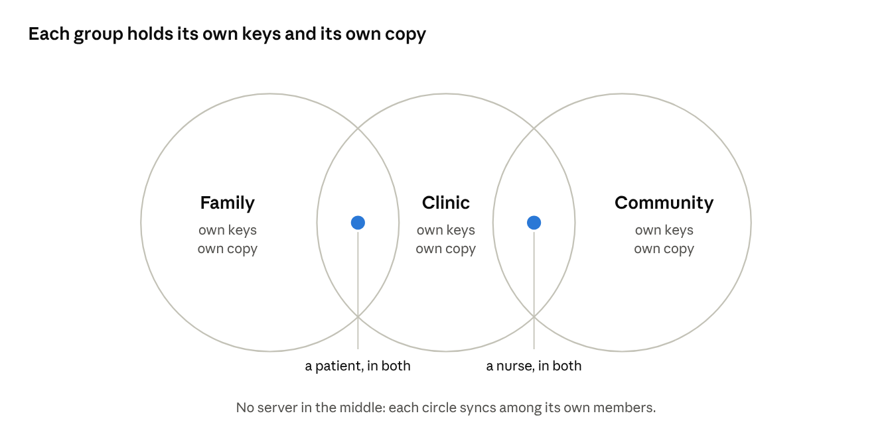
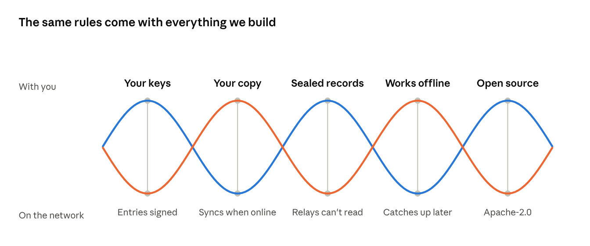
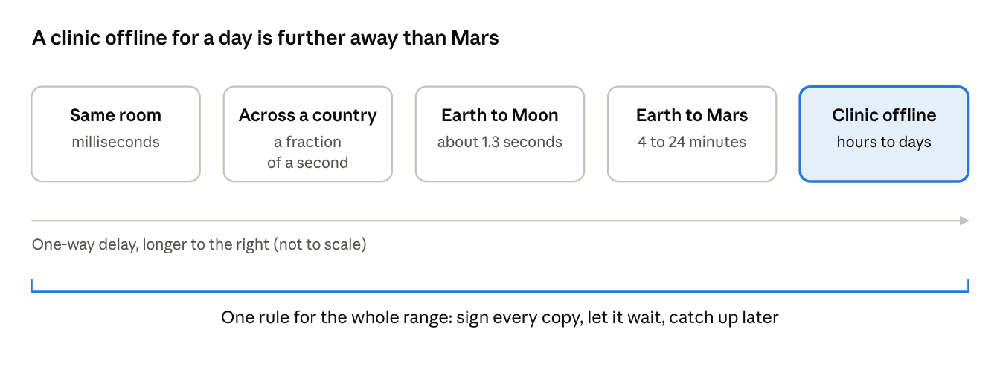
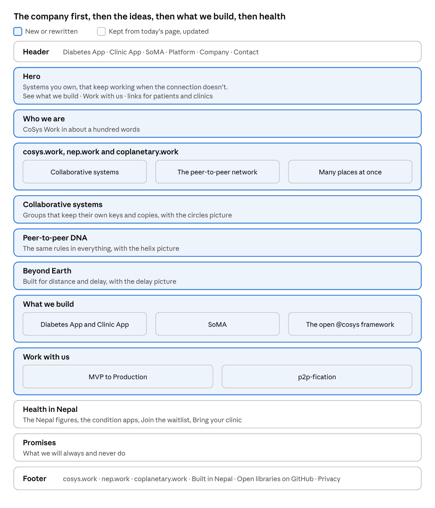

# cosys.work homepage: new introduction

*Draft copy, 1 November 2026. Editable copy: the Claude Doc [cosys.work homepage: new introduction](https://claude.ai/artifact/61eSgY6bcy5g6Zq91BhtfM). The site's copy source, `docs/cosys-work-site-content.md`, wins where they differ.*

## What the homepage says today

Today's homepage introduces a health product, not a company. Every section is about chronic care in Nepal, and the only place CoSys Work appears is the copyright line. There is nothing yet about collaborative systems, nep.work, coplanetary.work, the public posts app, or the consulting work.

| Section on the live page | What it says | Suggestion |
| --- | --- | --- |
| Hero | "Health care that keeps going between visits", with patient and clinic buttons | Move down to a health band; open with the company |
| One app for each condition | Diabetes "in closed pilot", four more conditions coming | Keep on the health band, with "in closed pilot" as the site's copy source (v4.3) has it |
| Peer-to-peer, private, sovereign | Data moves between chosen people, sealed, owned by the patient | Grow into the peer-to-peer section below; it is true of everything you build |
| Snap, share, follow the plan | The three-step diabetes flow | Move to the Diabetes App page |
| Why Nepal, why now | 22% of over-30s with high blood sugar in the capital's screening; 2 to 3 months between visits; 1 to 2 hours of intake | Keep on the health band |
| Comparison table | Against typical diabetes apps | Move to the Diabetes App page |
| Three products, one network | Diabetes App, Clinic App, the P2P Platform | Widen into "What we build", adding SoMA and the open framework |
| Promises | The doctor decides, the record is yours, built for hard cases | Keep for the health apps; add company-wide promises |
| Footer | "© 2026 CoSys Work Pvt. Ltd.", privacy, contact | Add cosys.work, nep.work and coplanetary.work, a link to the open libraries on GitHub, and the English and Nepali switch |

Two smaller gaps: the copy deck of 25 September asked for an English and Nepali switch, which the live page does not have, and every card uses an emoji where an illustration of your own would carry the brand better.

## What the new introduction should do

Open with who CoSys Work is and what holds its work together, then show health as the first proof. A visitor should know within one screen that this is a company building collaborative, peer-to-peer systems, that it starts from Nepal, and where to click if they came for the diabetes app.

1. Say what the company is in one sentence: collaborative systems that people own, that work offline and sync peer to peer.
2. Introduce cosys.work, nep.work and coplanetary.work early, as one band of three columns: cosys.work for collaborative systems, nep.work for the network, coplanetary.work for systems that span many places.
3. Give each idea its own screen with a picture: collaborative systems, the peer-to-peer DNA, and communication beyond Earth. Drafts of all three follow.
4. Show what you build today: the Diabetes App and Clinic App, SoMA, and the open framework of `@cosys` packages.
5. Show how to work with you: the two consulting offers, "MVP to Production" and "p2p-fication", for teams who want their own systems in production.
6. Keep the health story whole on its own band, with the Nepal figures and both buttons, so patients and clinics lose nothing.
7. Back the big claims with proof: the data-access architecture presented at the European Geosciences Union and archived at NASA ADS, once the founder confirms it is the architecture the apps use now; health apps that work in airplane mode; a mailbox that cannot read the mail it carries; libraries published under Apache-2.0.

Keep the claims honest. The beyond-Earth section describes a design principle and a direction; nothing of yours is in orbit, and the copy says so.

## Hero and company introduction

The hero carries one promise that is true of everything you build: it keeps working when the connection drops. The introduction under it says who you are in about a hundred words.

| Element | Draft copy |
| --- | --- |
| Headline (recommended) | Systems you own, that keep working when the connection doesn't. |
| Headline, other options | Collaborative software, peer to peer, from Nepal outward. · We build systems that work together and keep working apart. |
| Subhead | CoSys Work builds collaborative software that runs on the devices people already own. It works offline, syncs directly between the people who share it, and keeps every record with the people it belongs to. We started with chronic care in Nepal, where patients, families and clinics share one record without a central server. |
| Buttons | See what we build · Work with us |
| Links under the buttons | Living with diabetes? Join the waitlist · Run a clinic? Bring your clinic |
| Small print | Built in Nepal. Open-source libraries under Apache-2.0. |
| Visual | A phone, a laptop and a small clinic box joined by lines, with an empty space where a central server would usually sit |

**Who we are** (the block under the hero):

> CoSys Work Pvt. Ltd. is a software company in Nepal. Cosys stands for collaborative systems: software for families, clinics, teams and communities that need to work together without handing their records to a platform. We build our own products, starting with apps for people living with diabetes and the clinics that care for them. We also help companies, organisations and ministries move their systems onto machines they own. Our framework is open source, and the network it runs on, nep.work, has no centre to fail.

## cosys.work, nep.work and coplanetary.work

One band of three columns, straight after the introduction, so the names are explained before anyone meets them elsewhere on the site. Each column links to its own section further down.

|  | cosys.work | nep.work | coplanetary.work |
| --- | --- | --- | --- |
| One line | Collaborative systems | The peer-to-peer network, also called nepwork | Systems for many places at once |
| Introduction | Software for people who work together. Each family, clinic, team or community holds its own keys and its own copy of what concerns it, and every entry is signed by whoever wrote it. Collaborative editors, signed authorship and trust circles are the building blocks. | The network our systems run on. Phones, laptops, office boxes and community servers pass sealed records directly to each other. Relays carry what they cannot read, and any community can run its own node. | Systems built for distance and delay. Every copy is signed, can wait, and catches up with the others within known sync times: across town, across a country when the power goes out, and one day across planets. Eventually consistent social media is the first. |
| Example | A family and their clinic keep one diabetes record in step. | A patient's phone reaches a clinic's computer across Nepal with nothing in the middle that can read the record. | SoMA: write once on your phone, publish to every network, keep proof it's yours. |
| Visual | Three overlapping circles | A mesh of nodes; the relay drawn as a sealed envelope | Earth, Moon and Mars joined by a dotted line |

## Collaborative systems

This section shows the unit everything is built from: a group that already governs itself. Suggested site copy:

> **Built for people who work together**
>
> Most software treats you as one account on someone else's server. Ours starts from the groups people already belong to: a family, a clinic, a team, a cooperative. Each group holds its own keys, its own copy of what concerns it, and its own rules for who joins. Someone who belongs to two groups links them, and each group stays itself.
>
> Shared editing works offline and merges when people reconnect. Every entry is signed by whoever wrote it, and edits keep their history. You decide who sees what, and you can take it back.
>
> In the diabetes app, a patient chooses whether family sees the numbers, a colour, or only an alert.

The picture puts people in the overlaps: the patient is in the family and the clinic, and nothing sits in the middle holding everyone's records.

## Peer-to-peer DNA

The live page already has "peer-to-peer, private, sovereign" for the health apps. Widen it into a section about the whole company, drawn as a double helix: each rung pairs something that stays with you with something the network does. Suggested site copy:

> **Peer to peer is in our DNA**
>
> Everything we build starts from the same rules, and they come with every product, every engagement and every library we publish.
>
> Your keys stay on your devices, and every entry is signed with them. Your copy of the record is the record, and it syncs with the people you chose whenever there is a connection. Relays carry sealed mail they cannot read. Everything works offline and catches up later. The code is open under Apache-2.0, so anyone can check that all of this is true.
>
> The diabetes app logs readings, reads photos and shows trends in airplane mode. Its mailbox carries sealed deposits it cannot open.

One line under the picture can link to the libraries on npm, JSR and crates.io, and to the public mirror on GitHub.

## Beyond-Earth communication

This is coplanetary.work's section. It tells one idea in plain terms: the rules that keep a clinic working through a power cut are the rules a network between planets needs. It describes a direction and a design principle, and claims nothing in space. Suggested site copy:

> **Built for distance and delay**
>
> Most software assumes the connection is instant and always there. Ours treats delay and disconnection as normal: every copy is signed, can wait as long as it needs to, and catches up with the others in a known time.
>
> That is what keeps a clinic in rural Nepal working through a power cut, and it is the discipline a network between planets needs. Light takes about 1.3 seconds to reach the Moon, and between about 4 and 24 minutes to reach Mars, depending on where the planets are. A clinic that is offline for a day is, in network terms, further away than Mars.
>
> Space agencies solve this with delay-tolerant networking, which stores a message and forwards it when the next link opens. Signed, self-contained records suit that way of travelling. coplanetary.work is where we take it further: social media and shared records that stay consistent across any distance. \[Only once the founder confirms it: Our data-access architecture comes from geoscience and satellite data, and was presented at the European Geosciences Union and archived at NASA ADS.\]

The Moon figure is distance over the speed of light (about 384,400 km at about 300,000 km/s). The Mars range is from the European Space Agency. The delay-tolerant networking line points to the IETF's Bundle Protocol, RFC 9171.

## Page order

The new sections sit above the health story. Health keeps its own band, its figures and both buttons, and its step-by-step detail moves to the Diabetes App page.

The header gains SoMA beside the two apps. Work with us lives on the homepage and on the Company page, and the English and Nepali switch waits until reviewed Nepali pages exist. Every new paragraph above needs a Nepali version reviewed by a native speaker before launch, as the copy deck says.

Draft copy for the cards in What we build and Work with us:

| Card | Draft copy |
| --- | --- |
| Diabetes App and Clinic App | Apps for people living with diabetes and the clinics that care for them. The record stays on the patient's phone and at the clinic, and family see only what the patient chooses. The Diabetes App is in closed pilot, and the Clinic App is in development. |
| SoMA | Write once on your phone, post to every network, and keep proof that the words are yours. Anonymous by default, and joined by invitation. |
| The open @cosys framework | The libraries our products run on, free under Apache-2.0: `@cosys` packages on npm and JSR, and `cosys-` crates on crates.io. |
| MVP to Production | For teams with a working prototype and a reason to launch: a review across eight areas, a clear verdict, and a roadmap into production on systems you own. |
| p2p-fication | For organisations with systems already running: move data and workloads onto machines you own, add local business intelligence and language models, and keep working through internet and cloud outages. |

## Sources

The live page was read on 1 November 2026.

- [cosys.work homepage](https://cosys.work): today's sections, buttons and footer.
- Project note `claude/cosys-site-content.md` (copy deck v3, 25 September 2026): the language switch, the "no pilot" rule, the Platform page's EGU and NASA ADS line.
- Project note `claude/business-model.md`: the two consulting offers and the open framework.
- Project file *Health assistance and deliveries*: the data-access architecture from geological and satellite work, presented at the European Geosciences Union and archived at NASA ADS.
- Project note `claude/soma-architecture-notes.md`: the meanings of cosys.work, nep.work and coplanetary.work, and the public posts app.
- [ESA Mars Express blog, "Spacecraft event time vs. Earth receive time"](https://blogs.esa.int/mex/?p=257): one-way light time to Mars of about 4 to 24 minutes.
- [RFC 9171, Bundle Protocol Version 7](https://www.rfc-editor.org/rfc/rfc9171.html): delay-tolerant networking as store-carry-forward.
